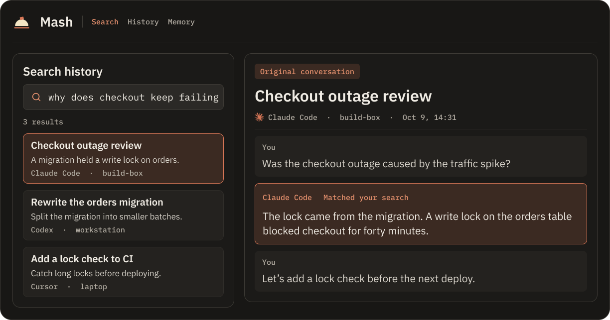

<p align="center">
  <picture>
    <source media="(prefers-color-scheme: dark)" srcset="assets/mash-logo-dark.svg">
    
  </picture>
</p>

<p align="center">
  <a href="https://github.com/mashium/mash/actions/workflows/ci.yml"></a>
  <a href="https://github.com/mashium/mash/actions/workflows/windows.yml"></a>
  <a href="https://getmash.io"></a>
  <a href="#licence"></a>
</p>

# mash - The **M**ulti-**A**gent **S**earch **H**istory Tool

[Español](docs/es/index.md) · [Français](docs/fr/index.md) · [简体中文](docs/zh-cn/index.md) · [日本語](docs/ja/index.md)

**Find past coding-agent chats and see why you made a decision.**

Mash searches the history Claude Code, Codex, GitHub Copilot, Cursor, OpenCode,
and Antigravity already saved on your machine. [Check support for your agent](docs/supported-agents.md).

Browse those chats in the [browser dashboard](docs/dashboard.md) with `mash dash`
or [search from the terminal](docs/search.md). You can also
[connect a coding agent](docs/agents.md) so it can search your history for you.

Mash is open source and self-hosted. The default setup keeps indexing and
search on your machine and needs no account. [How Mash handles your history](docs/privacy.md)

[Try the demo without installing](https://getmash.io/demo/) · [Quick start](#quick-start) · [Download and verify Mash](docs/downloads.md)

[](https://getmash.io/demo/#/chat/sign-in-tokens?node=laptop)

## Why Mash

- **Find a chat from before you installed Mash.** Search for an error,
  filename, or phrase across agents, or search by meaning with optional local
  models. Open the match with its surrounding messages and tool output.
  [Find the invoice export chat](https://getmash.io/demo/#/search?q=invoice+exports+queue)
- **See why you made a decision.** The plugin can save the decision with a
  quote from the chat. Open the original message in the dashboard or ask
  your agent to look it up later. [Follow a saved decision to its source](https://getmash.io/demo/#/record/record-sign-in-tokens?node=laptop)
- **Search across machines you run.** Find chats from your workstation on
  your laptop through your own Mash server. Each computer can still search
  its own history offline. [Multi-machine setup](docs/shared-index.md)

[Compare Mash with other coding-agent history tools](docs/compare.md).

## Quick start

[Try a sample search](https://getmash.io/demo/#/search?q=invoice+exports+queue)
and open a result in its conversation. Set up Mash below to search your own
chats in the browser, in the terminal, or through an agent you connect.

Before running a command, see [what setup changes](docs/installation.md#what-setup-changes)
and [how to verify the download](docs/downloads.md#verify-the-checksum).
To start with one agent and a short history range, follow the [local trial guide](docs/privacy.md#try-a-small-local-setup).

### Ask your agent

Paste this into Claude Code, Codex, or another coding agent.

> Read https://getmash.io/setup.md and set up Mash on this machine.
> Review the choices with me first.

You can start with the dashboard and choose whether to connect agents.

If you installed the [Mash plugin](docs/plugin.md#start-with-the-plugin),
you can ask for its `setup` skill.

### Install it yourself

You need at least one saved conversation from a [supported agent](docs/supported-agents.md).
The commands below install Mash, start local search, and start the
dashboard so you can set up Mash in your browser. For Homebrew, apt, Scoop or another
package manager, see the [package install commands](docs/install-methods.md#install-with-a-package-manager).
For the terminal wizard, see [set up in a terminal](docs/installation.md#set-up-in-a-terminal).

On macOS (Apple silicon) or Linux (x86-64 or ARM64), use the command below.
On Linux or WSL it needs a systemd user session to start Qdrant.
[Check your session or see other ways to start Qdrant](docs/local-search.md#linux-without-a-systemd-user-session).

```bash
curl -fsSL https://raw.githubusercontent.com/mashium/mash/main/install.sh | sh -s -- --dashboard
```

On Windows x64, the setup stores search data in a short folder on the system
drive, usually `C:\mash-qdrant\storage`. [See where Mash stores data](docs/privacy.md#where-mash-stores-data).
Run this in PowerShell:

```powershell
& ([scriptblock]::Create((irm https://raw.githubusercontent.com/mashium/mash/main/install.ps1))) -Dashboard
```

The scripts verify the downloads and install Mash into your `.local/bin`.
Qdrant (about 30 MB) runs under your user and starts at login. Word search
works without downloading any models.

Open the address the installer prints, usually [http://127.0.0.1:8790](http://127.0.0.1:8790).
Leave the terminal running. In the browser, review which histories Mash found
and how far back to look. The default range is 90 days.
If setup opens on the history choices, use **Next** to reach the review.

- **Search in the dashboard yourself.** Check that no agents are selected. If your version selects agents for you, choose **Skip agent connections** or turn them off on the agent screen.
- **Let an agent search for you.** Use **Choose agents to connect** or select them on the agent screen. Check which ones appear in the review.

Choose **Set up and index**. [See the dashboard setup steps](docs/dashboard.md#set-up-mash-from-the-dashboard)

To use a search service you already run or to install Mash separately, follow
the [installation guide](docs/installation.md).

<span id="try-it"></span>

### Find your first chat

When setup says search is ready, open **chats**. Type a word you remember, such
as an error or function name, and press Enter. Open a result to see the original
message in its conversation.

To reopen the dashboard later, run `mash dash` and open the address it prints.
If your terminal can’t find `mash`, use the full path shown during setup.
For commands that make `mash` available by name, see [command not found](docs/troubleshooting.md#mash-command-not-found).
If a chat is missing, see [what to check when search returns nothing](docs/troubleshooting.md#search-returns-no-results).
For non-English chats, see [word search examples in other languages](docs/search-languages.md).
See the [dashboard guide](docs/dashboard.md#find-and-read-a-chat) or
[search from the terminal](docs/search.md#your-first-search).

**Search from an agent.** Restart any agent you connected during setup. For
example, in Codex, ask “Use Mash to find what we decided about authentication
in Claude Code. Show me the message behind the answer.”
[Check an agent connection](docs/agents.md#confirm-the-connection) if it
cannot see Mash. If you skipped this during setup, you can
[connect an agent later](docs/agents.md#connect-claude-code-codex-or-copilot).

Keep new chats searchable with [`mash index` or a background watcher](docs/synchronization.md).
You can also [back up your history](docs/backup.md).

<!-- quick-start-end -->

<details>
<summary>Install with a package manager</summary>

These packages include the browser dashboard. After installing, [start
local search and choose which histories to read](docs/installation.md#start-the-local-search-service).
[Review the package sources and release checks](docs/install-methods.md#install-with-a-package-manager).

| Channel | Command |
| --- | --- |
| Homebrew | `brew install mashium/tap/mash` |
| apt, Debian and Ubuntu | [Add the Mash repository](docs/install-methods.md#apt-debian-or-ubuntu), then `sudo apt install mash-cli` |
| Scoop | `scoop bucket add mashium https://github.com/mashium/mash`, then `scoop install mashium/mash` |
| mise | `mise use -g github:mashium/mash` |
| cargo-binstall | [Install the release archive](docs/install-methods.md#cargo-binstall) |

</details>

## Privacy

With the default local setup, indexing and search stay on your machine.
Sharing history across your machines is optional.

Mash masks recognizable credentials in results by default, but detection is
best effort. Local history and exports can contain sensitive text;
treat backups like the original chats. Mash never modifies the contents of
the agent’s source history. When an agent searches through Mash, the results
it receives become part of that agent's context. [Privacy and redaction →](docs/privacy.md)

## Tested with

See [how each agent's history has been tested on Linux, macOS, and Windows](docs/supported-agents.md#tested-with).

## Build from source

On a platform without a prebuilt release, you can
[build Mash with the browser dashboard](docs/install-methods.md#include-the-web-dashboard)
or [build the terminal and agent tools with Cargo](docs/install-methods.md#cli-and-agent-tools).

## Documentation and contributions

[Browse the guides](docs/README.md), [get help with a problem](docs/troubleshooting.md),
or [report a security concern privately](SECURITY.md#report-a-vulnerability).
Before replacing an existing installation, read the [upgrade guide](docs/upgrades.md#upgrade-an-existing-installation).
To fix a guide, improve a translation, or send a code change, see [Contributing](CONTRIBUTING.md#where-to-start).

## Related projects

See [how Mash, Déjà Vu, CASS, Claude-Mem and SpecStory fit different workflows](docs/compare.md).

## Licence

Mash is licensed under either the [MIT licence](LICENSE-MIT) or the
[Apache License 2.0](LICENSE-APACHE), at your option.
