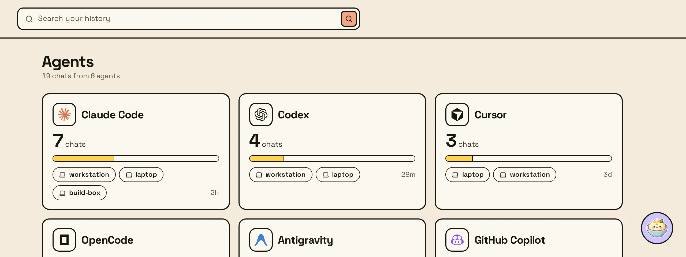
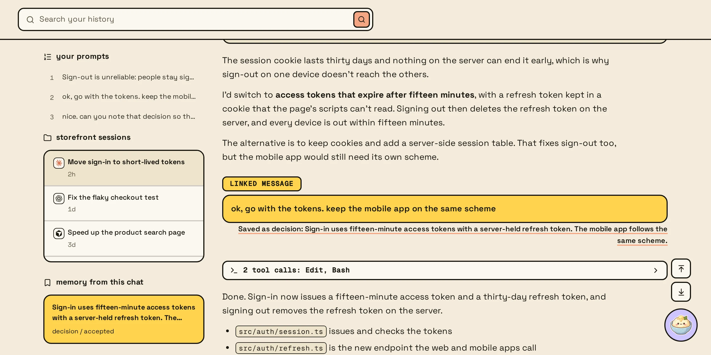
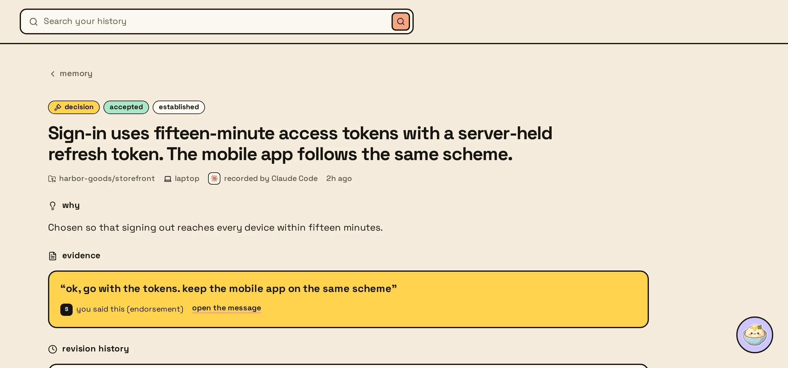
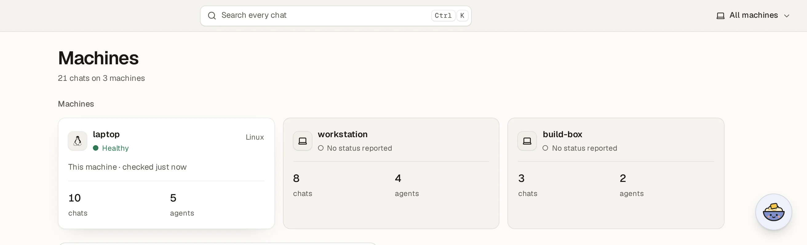
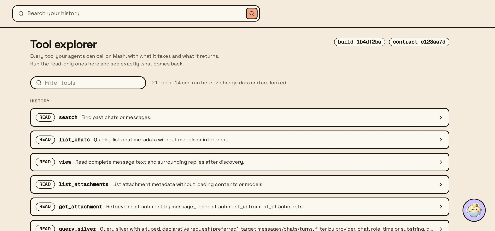

# Why Mash

Your coding agents have already worked through your hardest problems with
you. Mash keeps every one of those conversations, from every agent and every
machine, in one place you can search in milliseconds. It runs on your own
computer, with no account and no cloud.

[Try the demo](https://getmash.io/demo/) · [Install Mash](../README.md#quick-start)

## Every agent, one search

Claude Code, Codex, GitHub Copilot, Cursor, OpenCode and Antigravity each
keep their chats in their own place, in their own format. Mash reads them all
and searches them together, so you never have to remember which agent you
asked. [Supported agents](supported-agents.md)

## Straight to the message that matters

Search by an error, a function name or a half-remembered phrase. Mash
forgives small typos and, with optional local models, finds chats by what
they mean. Open a result and you land on the exact message, with the whole
conversation around it. [Introduction to search](search.md)

## Decisions that keep their receipts

With the plugin, your agent saves what you decide, and Mash checks the quote
against the chat it came from. Months later, a new session can ask what was
decided and why, and you can open the very message where you said it.
[Use Mash memory](records.md)

## All your machines in one place

Work on a laptop and a workstation? Share their chats through a Mash server
you run, and search both from either one. Each machine still searches its own
chats offline. [Set up a shared index](shared-index.md)

## Fast, small and private

- **66 ms** for an exact-phrase search across about 103,000 messages.
- **About 20 MB** of memory for an idle Mash MCP process.
- **Nothing leaves your machine** unless you choose to share it. There is no
  Mash account, and word search needs no model downloads.

[How these were measured](https://getmash.io/#welcome-speed) ·
[Privacy](privacy.md)

## Built for your agents too

Your agents can search Mash themselves, pick up where another agent left off,
and recall your decisions before they repeat a mistake. The tool explorer
shows every tool they can call, and runs the read-only ones for you.
[Use Mash from an agent](agents.md) · [Pick up where you left off](pick-up-work.md)

## Ask in plain language

Mashy answers questions about your history, like “why did staging deploy the
old image?”, and links each answer to the chats it came from. It uses your
own model service and key. [Ask Mashy](mashy.md)

Ready to find your own chats? [Install Mash and find your first conversation](../README.md#quick-start).
