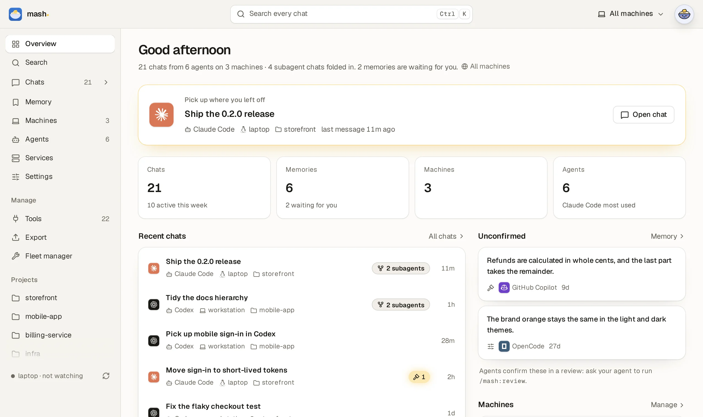
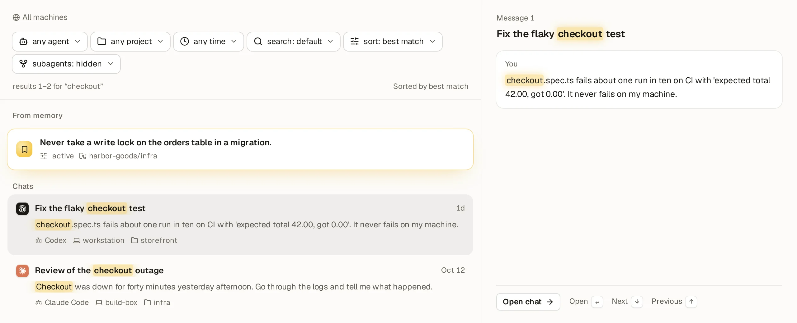
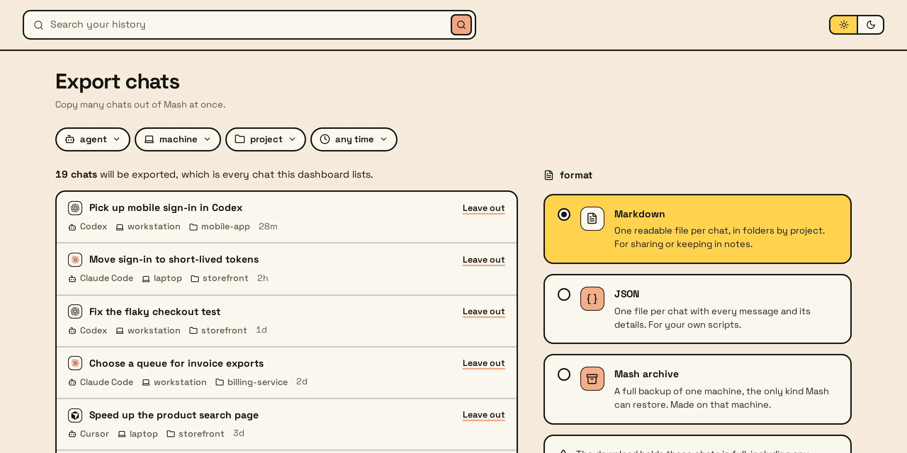

# Use the dashboard

Try a [search for invoice exports](https://getmash.io/demo/#/search?q=invoice+exports+queue)
in the browser demo. Open a result to see the original conversation. You can
also [open a saved decision](https://getmash.io/demo/#/record/record-sign-in-tokens?node=laptop)
and select **open the message** to see where it came from. The demo matches
exact words and phrases in sample chats.



- [Find and read a chat](#find-and-read-a-chat)
- [Save a transcript](#save-a-transcript)
- [Ask Mashy about your chats](mashy.md)
- [Open the dashboard on another device](dashboard-access.md)

Prebuilt Mash releases include the dashboard. If you compile Mash yourself,
[build with the dashboard](install-methods.md#include-the-web-dashboard).
After [installing Mash](installation.md), start it in a terminal.

```sh
mash dash
```

Open the address it prints, usually **[http://127.0.0.1:8790](http://127.0.0.1:8790)**,
in your browser. Once Mash is set up, the overview shows your latest chats and
memories. Leave the terminal running. Ctrl-C stops the dashboard. If the page fails to load,
[check dashboard startup](troubleshooting.md#the-dashboard-doesnt-open).

If startup output appears as JSON, the `dashboard` field contains the URL.
Mash uses that format on stderr when it is redirected to a file or pipe, and
older releases show it in the terminal too.

With the [plugin](plugin.md) installed, `/mash:dashboard` in Claude Code, or
asking your agent to open the Mash dashboard, does both steps for you.

The default local dashboard opens without a sign-in. Read [Keep access private](dashboard-access.md#keep-access-private)
before changing its listening address.

## Set up Mash from the dashboard

You can do first-run setup in the browser instead of running `mash init` in a
terminal. Start `mash dash` and open the dashboard: on a machine with no
configuration it opens on setup by itself, as a screen of its own without the
rail or search. **Skip to the dashboard** leaves it. Later, open **settings**
to return to setup and [connect an agent without indexing again](agents.md#connect-claude-code-codex-or-copilot).

Review the histories Mash found, the history range, and the installed agents it
can connect so they can search. **Show history folders** lists the paths.
By default, Mash reads history files or sessions updated in the last 90 days
on this machine. Those can include older messages. Choose **Set up and index**
to accept the review, or **Customize setup** to change the histories, range,
or agent connections before confirming.
To search on your own, check that **connect Mash to** says **no agents**.
To let an agent make requests, open **Choose agents to connect** and select
the agents you want, or use the agent screen under **Customize setup**.
If your version starts with agents selected, choose **Skip agent connections**
or turn the selections off on the agent screen. If it starts on the history
choices, use **Next** to reach that screen and the review.

Skipping connections applies to this setup. For an agent you connected before
or a plugin you installed separately, see
[Choose what your agents can access](privacy.md#choose-agent-access).

Nothing changes until you choose **Set up and index** or **Set up without
indexing** on the review. Mash then writes its configuration file, has each
chosen agent's own command-line tool connect it, and starts indexing in the
background if you asked for it. The page shows what was written, which files
each agent's tool edited and the commands that undo it. It follows the first
index until your chats appear.

- Indexing needs the search service. If it is stopped, start it using the
  method you installed it with. If Mash shows a connection problem, check the
  reason and [fix the search service](troubleshooting.md#qdrant-connection-failed).
  Then choose **Check search service again**. You can choose **Set up without
  indexing** to save your settings first. After the check passes, the saved
  setup screen shows the command to index your chats.
- To search by meaning, [set up the models and build search data](indexing.md#enable-semantic-search).
  You can then [choose meaning for a search](#choose-a-search-mode).
- Going through setup again on a machine that is already set up rewrites the
  configuration with your answers and keeps the previous file beside it.
- Sharing with other machines, memory backfill and history kept in other
  locations are not offered here: use `mash init` or edit the configuration
  file.
- A dashboard that other machines can reach runs setup only when it was
  started with a services configuration, like the settings page.

## The rail

The left rail is the way around. On a phone it opens from the menu button.

- **overview:** your latest chats and memories, and each machine and agent
  with its chat count.
- **chats:** every chat, newest first, with a search box. **viewing history**
  lists chats you opened in this browser session; each reopens where you left
  it.
- **agents**, **machines** and **projects:** one page each, with its recent
  chats and how they break down by the other two.
- **memory:** saved decisions, preferences and facts.
- **services** and **fleet manager:** process and database checks, each
  machine's agent setup, and fleet actions. The fleet manager appears only
  where fleet control is set up. See [services](services.md).
- **tool explorer:** every tool your agents can call on Mash, with its
  parameters. Run a read-only tool to see the reply as an agent receives it.
  Tools that change data are listed but cannot be run here.
- **settings:** check whether search is ready, choose which histories Mash
  reads, and control sharing, privacy, and Mashy on this machine.
  [Change dashboard settings](dashboard-settings.md).

### Check if local search is ready

Open **settings** and look at the search status at the top. The message counts
under **storage** describe the history Mash has saved. Local search also
needs a running search service and an up-to-date search index.

If Mash cannot use the local search service, [check what went wrong](troubleshooting.md#qdrant-connection-failed)
before indexing again. Word search works without models. Install models only
if you want to [search by meaning](indexing.md#enable-semantic-search).

## Find and read a chat

Open **chats**, type a word you remember into **Search your history**, and
press Enter. Open a result to jump to the matching message in its chat.
Without a query, the page lists your chats. Narrow either list with the chips
for agent, machine, project and date. A changed chip has a dashed border until
you choose **Apply filters**. Applied filters appear as tags in the search box.
Choose a tag to remove it.



If a filtered search comes back empty, choose **Clear filters** to try the
same query across your chats. If your dashboard opens the chat list, submit
the query again. Choose **Browse chats** to open the chat list with the
current filters. Use your browser's Back button to return to the search.
Choose **Check for updates** at the foot of the rail after refreshing the index. If you still can’t find
what you’re looking for, [check for a missing chat](find-missing-chat.md).

A transcript shows your messages on the right and the agent's replies on the
left. Runs of tool calls and reasoning are folded into one line; open it to see
each step and its output. The side panel lists your prompts on the current
page, other chats from the same project and memory saved from this chat.

Hover over a message to see its copy actions. On a phone they appear below the
message. Choose **Copy link to message** beside **Copy message** to paste a link
to the exact message into a note or handoff. Only the URL goes to your clipboard.
The link works while the message is indexed and the reader can reach that
dashboard. A local link works on the computer running the dashboard, and a
[private remote dashboard](dashboard-access.md)
still requires sign-in.

Use **Open in Codex** or **Open in Claude** (on a Mac, for this computer's
chats), **Copy resume command** or **Copy session ID** to
[reopen an original session](pick-up-work.md#reopen-the-original-session),
or [pick up the work in a new session](pick-up-work.md#ask-an-agent-for-a-recap).

Chat and memory views are read-only.

### Choose a search mode

After submitting a search, look for **search: default** beside the filters.
The label shows **default (words)** or **default (meaning)** once results
come back. Open the menu to choose **words** or **meaning**, then select
**Apply filters** to run the query again.
The **words** mode matches terms from the chat, including
[words from chats in other languages](search-languages.md). The **meaning** mode uses the
[optional models](indexing.md#enable-semantic-search) and takes English
queries. The choice follows the result pages for this query. A different
query starts with [the configured default](configuration.md#search-defaults).
If your dashboard does not show the menu, choose the mode with
[`mash search --intent`](search.md).

## Inspect conversation records

Open **memory** in the rail. Switch between decisions, preferences and facts
with the chips at the top, search statements with **find a statement**, and filter
with the status, review and source chips. Source chooses this machine's
records or those published to your shared group. Choose **Apply filters** to
run the search and **Next page** to continue.

Open a record to read its revision history, quoted supporting messages and
related records. **open the message** under a quote opens the cited chat
message. In a transcript, **memory from this chat** lists records that cite
the chat in any retained revision, and a quoted message shows **Saved as**
beneath it.

Lists include candidates and retired records. Check the status, expiry dates,
evidence warnings and declared conflicts before relying on a record. Reading
never confirms or changes one; ask your agent to make changes through Mash's
[record tools](records.md). If a shared record's source is unavailable, its
link produces an error rather than opening a local copy.

## Keep your place

The dashboard follows history as Mash updates it, on this machine and on the
machines that publish to your shared index; what you are reading never moves
by itself.

- **Lists of chats and memories** (the overview, the rail, recent chats, the
  session list beside a transcript, the agent, machine and project pages, and
  the memory pages) show what is new within a few seconds.
- **An open transcript** gains new messages at the end while you are at the
  bottom of the chat, and the view follows them. Anywhere else in the chat, an
  **N new messages** button appears instead; choose it to go to them. Text
  already shown never changes by itself: if Mash re-reads an earlier message,
  **Show updated messages** applies it.
- **A submitted search**, of chats or of memories, keeps its results and
  filters until you submit again, including when you open a result and return
  with your browser's Back button.
- **An open memory record** changes only when you choose **Check for
  updates**.

Chats and memories from other machines arrive as each machine publishes them.
That needs a shared server at least as new as this dashboard. With an older
one, or with more than 16 dashboard tabs open at once, load them yourself:
**Check for updates** at the foot of the rail. It reads again everything the
page shows, including an open transcript.

If the connection drops, in the browser or between the dashboard and the
shared server, it reconnects by itself and then catches up.

To show new conversations, [refresh your chat history](synchronization.md#refresh-now).
The dashboard follows the index as it updates.

If a request fails, an error panel names what could not load and offers
**Retry**. A connection error means the browser could not reach Mash, not that
chats or memories were deleted. Check the connection and that `mash dash` is
still running, then choose **Retry**.

## Ask Mashy

Mashy is the optional assistant in the dashboard. It can answer a question
about your chats and link to the messages behind its answer. It needs a model
service and API key you provide. [Set up and use Mashy](mashy.md)

## Save a transcript

Use the transcript's **Export** menu to download the whole chat as Markdown or
HTML, including tool output. **Export to PDF** opens a printable copy; choose
**Save as PDF** in your browser's print dialog.

For a stable copy, wait for indexing to finish first. Downloaded transcripts
may contain sensitive information.

Each chat has its own address, `http://127.0.0.1:8790/#/chat/<chat id>`.
With the [plugin](plugin.md), `/mash:export` finds the chat you mean and
opens it there.

## Export many chats at once

Open **chats**, then **export chats**. Narrow the list with the agent, machine,
project and time filters; every matching chat is exported, on every page,
unless you untick it. Choose **Markdown** to read or **JSON** for scripts, then
**Export**. Your browser saves one `.zip` file with a folder per project and a
file per chat.



Keep the page open until the download starts. If any chat cannot be read, the
export stops and saves nothing. Attachments are not included. The files hold
the chats in full, including anything sensitive said in them.

These exports and saved transcripts cannot be brought back into Mash. For a
copy Mash can restore, use
[a portable backup](backup.md#make-a-portable-backup). Chats from your other
machines appear in the dashboard through [sharing](shared-index.md).

## Open it from your phone or another computer

Follow [Open the dashboard on another device](dashboard-access.md) to sign in
from a phone or another computer.

<span id="set-it-up-by-hand"></span>

For Windows or another HTTPS reverse proxy, [set up access by hand](dashboard-access.md#set-it-up-by-hand).

<span id="keep-access-private"></span>

[Keep access private](dashboard-access.md#keep-access-private) explains when the
dashboard requires sign-in.
