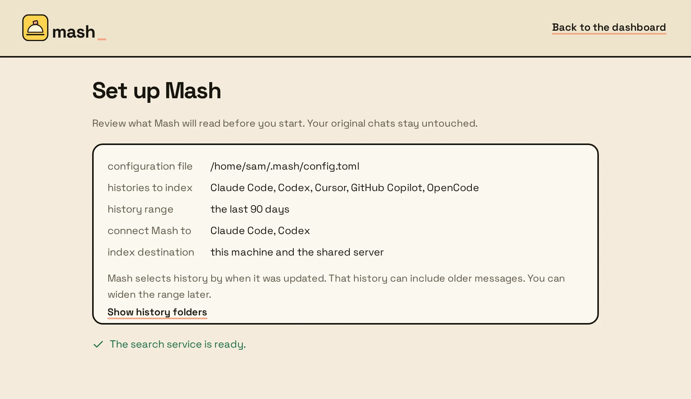

# Install Mash

- **Installing for the first time?** [Follow the Quick start](../README.md#quick-start)
  to install Mash, set it up in your browser, and find your first chat.
- **Installed Mash and still need to set it up?**
  [Start the local search service](#start-the-local-search-service), then choose
  which chats to search in your browser or terminal.
- **Already using Mash?** [Upgrade Mash](upgrades.md#upgrade-an-existing-installation).

[See what setup changes](#what-setup-changes) or
[choose another way to install](#get-mash-for-your-system).

## Start the local search service

The Quick start starts the search service for you. If you installed the
programs separately, or the installer stopped after printing “Installed”, run
the command below. Use the path the installer printed if your
[terminal can’t find Mash](troubleshooting.md#mash-command-not-found).

On Linux or WSL, the command needs a
[systemd user session](local-search.md#linux-without-a-systemd-user-session).
On Windows, it needs a [desktop sign-in](local-search.md#check-or-restart-the-service).
If you already run a [compatible local Qdrant](#run-qdrant-yourself), go on
to [connect your histories](#connect-your-histories).

```sh
mash qdrant install
```

Once it starts, [set up in your browser](#set-up-in-your-browser) or
[set up in a terminal](#set-up-in-a-terminal). If it fails,
[check the search service](troubleshooting.md#qdrant-connection-failed).

## Connect your histories

Use the browser dashboard or terminal wizard to choose which chats Mash reads.
You can [skip agent connections](#skip-agent-connections) and search on your own.

### Set up in your browser

If you installed a release or [built with the dashboard](install-methods.md#include-the-web-dashboard),
run this in a terminal:

```sh
mash dash
```

Open the address Mash prints and leave the terminal open. Review which chats
Mash will read. To search on your own, [skip agent connections](#skip-agent-connections)
before choosing **Set up and index**. When search is ready,
[find your first chat](#try-your-first-search).
[See the dashboard setup steps](dashboard.md#set-up-mash-from-the-dashboard).



### Set up in a terminal

Run the terminal wizard in an interactive terminal. Use it for a build without
the dashboard or to choose a history folder or connect to a shared server.

```sh
mash init
```

Review the histories and choose whether to connect agents. Choose
**Set up and index** to apply your choices, or
[index without connecting agents](#skip-agent-connections). To change the
options, choose **Customize setup**. If asked where to search, choose
**Just this computer (recommended)** for local setup. Press Esc or Ctrl-C
to cancel before applying changes. Once setup is done,
[try a terminal search](search.md#your-first-search).
[See more terminal options](#setup-options).

### Skip agent connections

- **In the browser**, check that **connect Mash to** says **no agents** before
  you choose **Set up and index**. If agents are selected, open
  **Choose agents to connect** and turn them off. On older versions, use
  **Next** to reach the agent choices and turn off each selection there.
- **In the terminal**, choose **Set up and index without connecting agents**
  if offered. If asked **Which agents should get access to Mash search?**,
  press Space to clear each selection, then press Enter. Decline memory
  backfill if asked. If the review lists no agents, choose **Set up and index**.
  You can also start the wizard with `mash init --no-agents`.

Skipping connections leaves existing connections and plugins in place. You can
[remove an existing connection](agents.md#disconnect-an-agent) or
[connect an agent later](agents.md#connect-claude-code-codex-or-copilot).

## Try your first search

Once setup says search is ready, open **chats**. Search for a word you
remember, such as an error or function name, and open a result to read the
original message. If the dashboard is closed, run `mash dash` and open the
address it prints.

You can also [search from the terminal](search.md#your-first-search). If you
connected an agent, start a new session and [ask it to find a chat](agents.md#try-it).
If a chat doesn’t appear, [find a missing chat](find-missing-chat.md).

Word search needs no models. To add search by meaning, follow the
[optional model setup](indexing.md#enable-semantic-search).

## What setup changes

The Quick start checks the release checksum, installs `mash` and `mash-server`,
and starts the local search service (Qdrant). It starts the dashboard and
prints the link to open in your browser. Mash disables Qdrant telemetry and
limits it to connections from this computer. Qdrant runs under your account
and starts again when you log in.
[See the search service files](local-search.md#where-qdrant-stores-data).

You choose what to index before Mash saves its settings. By default, Mash keeps
the searchable copy on this computer, and it leaves the agent’s original chats
untouched. Connecting an agent changes its settings so it can ask Mash for
excerpts. [See how Mash handles your history](privacy.md) or
[try Mash with one recent history](privacy.md#try-a-small-local-setup).

If you stop after installing, `mash uninstall` shows what’s been installed
and how to remove it. [Preview removal](uninstall.md).

<span id="install-the-cli"></span>

## Get Mash for your system

To install just the programs, use the scripts below, [verify and unpack a
release archive](downloads.md), or choose a package manager or source build.
Then [start the local search service](#start-the-local-search-service).

<span id="recommended-release-installers"></span>

### Install only the Mash binaries

Prebuilt releases cover Linux x86-64 and ARM64, macOS Apple silicon, and
Windows x64 and ARM64. The Linux binaries need glibc 2.34 or newer, available in
Ubuntu 22.04, Debian 12, RHEL 9 and later. Alpine and other musl systems,
and Intel Macs, aren’t supported.

#### macOS or Linux

```sh
curl -fsSL https://raw.githubusercontent.com/mashhq/mash/main/install.sh | sh
```

WSL uses this command too.

#### Windows

```powershell
irm https://raw.githubusercontent.com/mashhq/mash/main/install.ps1 | iex
```

Both scripts check the release checksum, install to `.local/bin` in your home
directory, and print commands with the installed path. They leave your shell
profile unchanged. Set `MASH_VERSION` to a published tag to pin a release
or `MASH_INSTALL_DIR` to choose another directory.

### Package manager alternatives

[Install with Homebrew, apt, Scoop, mise, or cargo-binstall](install-methods.md#install-with-a-package-manager).

### Build from source

[Include the browser dashboard](install-methods.md#include-the-web-dashboard)
or [build just the terminal and agent tools](install-methods.md#cli-and-agent-tools).

### Run Qdrant yourself

You can [reuse a local Qdrant 1.20+ instance](local-search.md#run-qdrant-yourself)
or start one on your own.

- <span id="optional-qdrant-docker-image"></span>[Qdrant in Docker](local-search.md#optional-qdrant-docker-image)
- <span id="native-windows-without-docker"></span>[Windows without Docker](local-search.md#native-windows-without-docker)
- <span id="native-macos-or-linux-without-docker"></span>[macOS or Linux without Docker](local-search.md#native-macos-or-linux-without-docker)

## Setup options

To install and open the terminal wizard in one command, use the
[Quick start command](../README.md#install-it-yourself) with `--setup` instead
of `--dashboard` on macOS or Linux, or `-Setup` instead of `-Dashboard` on Windows.
Run it in an interactive terminal.

On a fresh setup, the terminal wizard reviews the history folders it found,
the history range (files or sessions updated in the last 90 days), and the
agents it can connect. Mash can read saved chats even if the agent’s command
is missing. **Customize setup** lets you choose a range, pick history folders
or agents, connect to an [existing shared server](shared-index.md), or save
settings without indexing. It can also offer an optional
[memory backfill](records.md#backfill-earlier-memory) after indexing. Backfill
uses your signed-in Claude Code or Codex and sends selected chat text to its
model service.

Before indexing, the wizard checks the local search service and, if you
configured sharing, server authentication. If a check fails, choose
**Save configuration only**, fix the connection, then run `mash index`.
That option saves settings and skips agent connections and indexing.

The history plugin’s hooks need Python 3.9+.
[Use Mash with your agent](agents.md).

### Without the wizard

`mash init --yes` accepts the detected defaults: sources modified within the
last 90 days, including current sessions of all detected supported agents
(Copilot too), and available agent integrations, without historical memory
backfill. Runs without terminal input or terminal stderr are non-interactive
too. The JSON result lists the selected provider folders.

Without the wizard, `mash init` checks Qdrant before changing anything. If
Qdrant does not answer, it exits with the commands to start it and leaves
configuration and agent settings untouched.

| Flag | Effect |
| --- | --- |
| `--no-index` | Configure without indexing. Skips the Qdrant check and lists starting Qdrant among the next steps. To choose folders yourself, edit the [configuration](configuration.md), then run `mash index`. |
| `--no-agents` | Skip new agent connections. Existing connections remain. |
| `--force` | Non-interactive setup keeps existing configuration unless this is passed. With `--yes`, regenerates configuration from detected histories. In the wizard, opens the settings review directly. |

Without `--force`, the wizard offers to keep existing settings or review them.
Reviewing preserves settings outside the wizard and backs up the previous file.

You can read your history before Qdrant runs: run `mash init --no-index`, then
`mash index`. Indexing saves your chats on this machine before it needs Qdrant,
then stops with the commands to start it and says how many chats it saved.
Meanwhile `mash search` finds them by word, newest first, and `mash list-chats`
and `mash view` read them. Once Qdrant runs, run `mash index` again for ranked
search.

### Read the result

The terminal wizard ends with a short report and a next step. Once search is
ready, look for the command to start the dashboard or a terminal search,
depending on your build. For the full JSON report, run `mash init --yes` or
redirect the wizard's stdout with `mash init > setup.json`. Prompts and progress
go to stderr.

- `"agents": []` means no agents were connected, even if indexing succeeded.
  Read `next` for the reason and follow [agent setup](agents.md). CLI search
  works without an agent.
- Each connected agent lists the settings `files` its CLI edited and the `undo`
  commands that remove the connection.
- `index_error` means the first index failed after setup was applied (for
  example, Qdrant stopped or its gRPC port is unreachable). The command exits
  with that error, but the configuration, agent registrations and history
  already saved are kept and still listed. Fix the cause, then run `mash index`.
- `written: false` on a rerun means the existing configuration was reused, not
  that setup failed.
- The searchable message count covers user and assistant dialogue only. Tool
  output and reasoning can be read in a chat but are excluded from search, so
  the count can be much smaller.

## Check the release download

[Choose a release archive and check its checksum](downloads.md), or
[inspect the installer before running it](downloads.md#inspect-the-installer).

## Uninstall

Preview what Mash would remove with `mash uninstall`. [See what stays on your computer and how to uninstall](uninstall.md).
