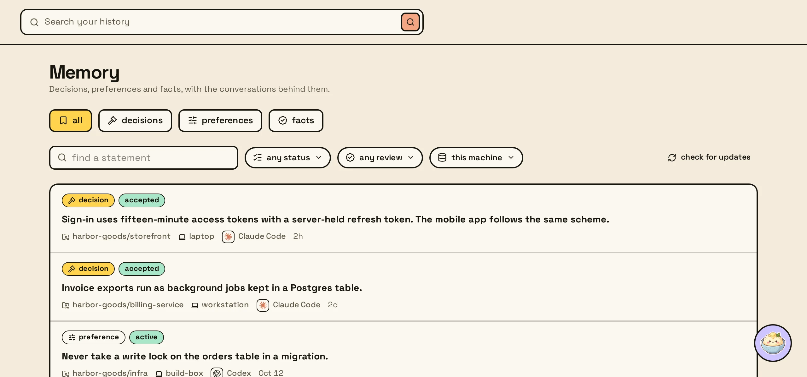
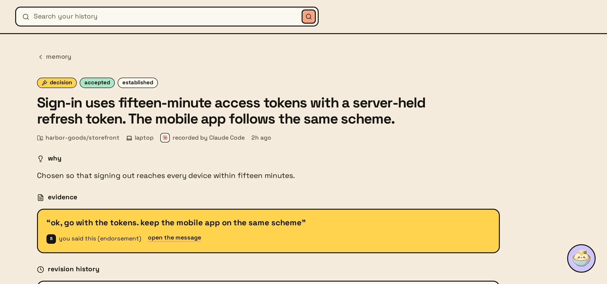

# Use Mash memory

Mash can save a decision, a preference or a note with a quote from the chat
where it came up. Open the quote whenever you want to check the context.

## Inspect existing records

[Open a saved decision in the demo](https://getmash.io/demo/#/record/record-sign-in-tokens?node=laptop)
and select **open the message** below its quote. The demo jumps to the
message about keeping the refresh token in the device keychain.



For your own history, run `mash dash`, open the address it prints, and choose
**memory**. Open a record to see its source, revisions, and related records.
[Find and filter memory in the dashboard](dashboard.md#inspect-conversation-records)

## Save a conclusion

With the [Mash plugin installed](plugin.md#start-with-the-plugin), ask an agent
in the conversation to save a decision for future sessions.

> Remember that this project keeps its refresh tokens in the device keychain.

In Claude Code, you can also use `/mash:remember`. In Codex or Copilot,
ask the agent to use the `remember` skill.

Use a note for anything worth keeping that isn't a choice, such as where a
service runs or when a job resets.

> Note that the staging database is reset every Monday.

In Claude Code, `/mash:note` saves a note directly; `/mash:remember` also saves
a note when what you ask it to keep is not a decision or a preference. Check the saved statement in the
agent's reply, then open **memory** to see the quote in context.

## Recall records

In a later conversation about the same project, ask “What does Mash remember
about refresh tokens? Show me where we decided that.” In Claude Code, you
can also use `/mash:recall refresh tokens`.

The plugin can bring a few relevant memories into a new session and when the
agent reads a file. An agent can also search past chats for decisions Mash
hasn't saved as memory. [Use Mash from an agent](agents.md#try-it)

## How saving works

Mash checks the quote against the original chat. That gives you a source to
read yourself. Agents can still miss or misread what you meant.



- The agent can establish decisions and preferences based on your own words.
  Other interpretations may appear as **candidates** that need review.
- A note is saved only when you ask for one, so it never waits for review.
- The agent can save its own choices as agent decisions. Your decisions take
  precedence over the agent's choices.
- If an indexed chat changes and the quote no longer matches, Mash marks
  the source as stale and leaves it out of ordinary recall.

Saving uses the agent already running. The plugin can notice conclusions
as you work and periodically remind the agent to save anything it missed.
In Codex, review changed plugin hooks in `/hooks` to enable them.
[See what the plugin does automatically](plugin.md#what-happens-without-asking)

Set `MASH_RECORD_CAPTURE=off` to stop automatic memory capture while keeping
recall. Set `MASH_RECORD_RECALL=off` to stop automatic memory recall while
keeping chat hints. [Plugin settings](plugin.md#what-happens-without-asking)

## Correct or replace

If a record is wrong or you changed your mind, ask the agent to update it
using the conversation where you made the correction. Use the `review`
skill, or `/mash:review` in Claude Code, for candidates, stale sources and
conflicting decisions. Looking at a record leaves its status untouched.

You can also ask the agent to forget a record. That removes its revisions
and quotes. If you [forget a cited chat](privacy.md#remove-a-chat), Mash also
removes the dependent records.

## Backfill earlier memory

Backfill is an optional review of older chats that can suggest memories. It
uses your signed-in Codex or Claude Code and sends selected chat text to
that agent's service, using its token budget. Normal indexing and
`mash init --yes` leave backfill off.

You can choose it during interactive setup for chats active in the last
three days. Run this command to review already indexed chats later.

```sh
mash init --yes --no-index --no-agents --backfill-memory codex
```

Use `claude-code` in place of `codex` if you prefer. Review the suggested
memories before relying on them. Mash stops after 100 chats or an unfinished
review, with up to ten minutes per chat. Run the command again to continue.
Mash skips completed reviews unless the chat changed.

### Shared records

If you publish history to a [shared Mash server](shared-index.md), you can
read published records in the dashboard. Records tied to a local project
path stay on that machine. [Read a shared record's source](dashboard.md#inspect-conversation-records)

## Back up records

[Mash's portable backup](backup.md#make-a-portable-backup) includes your
memories, their revisions and the quoted chat text. Treat it as privately as
the original chats.

<span id="check-for-duplicates"></span>
<span id="relate-conclusions"></span>
<span id="review-an-older-chat"></span>

## Call the memory tools directly

For tool arguments and examples, see [MCP tools for saved memory](record-tools.md).
