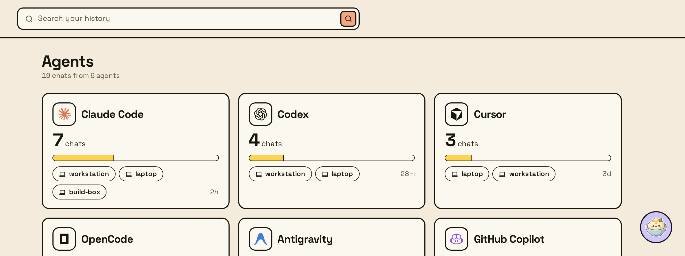

# Supported agents

Search saved chats in the [browser dashboard](dashboard.md) with `mash dash`
or from the [terminal](search.md). Both work with any of the histories below.

You can also [connect an agent](agents.md#connect-claude-code-codex-or-copilot)
and ask it to find past work for you. This is optional. A connected agent can
search any history you've indexed, including chats from other agents.

[Set up Mash and find your first chat](../README.md#quick-start).

| Agent | Saved chats Mash can read | Connect with `mash init` |
| --- | --- | --- |
| Claude Code | Local Claude Code conversations | Yes |
| Codex | Local Codex conversations | Yes, through the Codex CLI |
| GitHub Copilot CLI | Local command-line sessions | Yes, through the Copilot CLI, in Mash 0.2.0 and later. [Manual connection in v0.1.1-alpha and earlier](plugin.md#github-copilot-cli) |
| GitHub Copilot Chat in VS Code | Chats saved by VS Code on your computer | — |
| OpenCode | Conversations in the local OpenCode database | — |
| Cursor | Command-line chats and supported editor chat formats | — |
| Antigravity | Conversations saved in local app and IDE databases | — |

For clients that support local MCP servers over standard input and output,
see [how to connect manually](mcp.md#connect-another-mcp-client).

## If a chat is missing

Run `mash init` to review which agents Mash found and which histories it will
read. If Mash is already set up, choose **Customize setup** to change your
selection. If you keep your history in a custom location, use the
[configuration guide](configuration.md#choose-histories-and-an-age-limit) to add it.

Run `mash index` to read newly saved chats. By default, Mash starts with the last
90 days. See [how to include older chats](indexing.md#add-older-history) and
[where VS Code remote sessions are saved](indexing.md#copilot-in-vs-code-remote-windows).

## Tested with

These are the histories Mash has indexed and searched so far.

| Agent | Linux | macOS | Windows |
| --- | --- | --- | --- |
| Claude Code | Daily use | Daily use | Light use |
| Codex | Daily use | Daily use | Light use |
| GitHub Copilot | Light use | Light use | Recorded history only |
| OpenCode | Recorded history only | Light use | Simulated in CI |
| Antigravity | Recorded history only | Light use | Recorded history only |
| Cursor | Recorded history only | Partial | Recorded history only |

- **Daily use** covers hundreds of real chats from an installed agent on that system.
- **Light use** covers fewer than twenty real chats from an installed agent.
- **Simulated in CI** means an automated test writes history as the agent would
  while Mash indexes it.
- **Partial** means Mash read chats from a real Cursor CLI installation.
  Some older Cursor editor formats are unsupported.
- **Recorded history only** means tests use records in the agent's format.
  Verification against an installed copy on that system is still pending.

[Linux CI](https://github.com/grep-stack/mash/actions/workflows/ci.yml) and
[Windows CI](https://github.com/grep-stack/mash/actions/workflows/windows.yml) run
on pushes. [Apple Silicon build and smoke checks](https://github.com/grep-stack/mash/actions/workflows/macos-build.yml)
run on demand. If your chats are missing or look wrong, you can
[open an issue](https://github.com/grep-stack/mash/issues) with the agent name,
version, and operating system.
